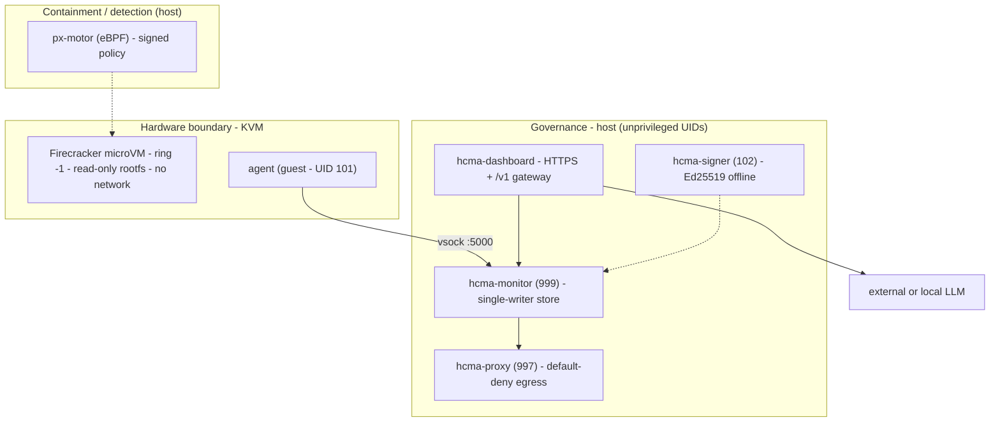
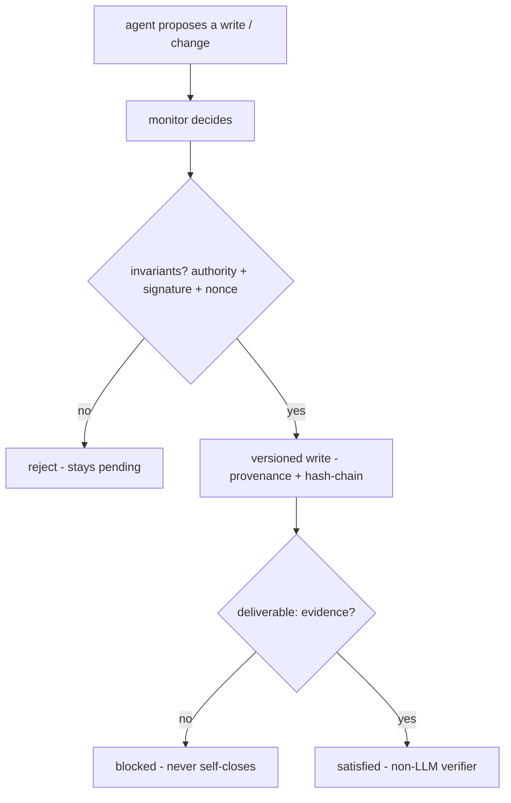
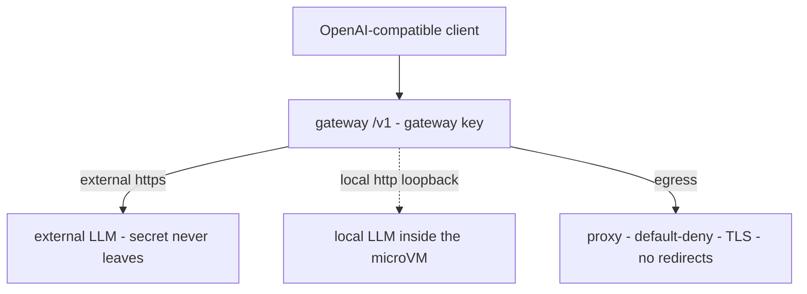

# HCMA — Governed, Versioned Memory for LLM Agents

**HCMA** (Hipocampo / _Hipocampo_) is a **governed, versioned memory system** for LLM agents:
every fact carries **provenance**, a **monotonic version**, and an **integrity hash-chain**, so an
agent can *remember* without *inventing*. The memory is **write-governed** (a single-writer
monitor), **auditable** (provenance + lineage + hash chain), and supports **governable deletion**
(retract specific facts by lineage, without touching unrelated knowledge).

The pipeline is: `user → orchestrator → { memory | alias | calculator | skill | LLM } → user`,
with **memory-first deterministic recall** (the LLM never decides whether a fact exists).

## Architecture (three layers)

| Layer | Component | Role |
|---|---|---|
| **Governance** | `hcma-monitor`, `hcma-proxy`, `hcma-dashboard` | Memory store, write-governance, signed provenance, web UI + OpenAI-compatible LLM gateway |
| **Hardware boundary** | Firecracker microVM | Untrusted workload runs inside a KVM microVM (vsock to the monitor) |
| **Containment** | `px-motor` (host-side eBPF) | Detects escape attempts of the microVM subject and raises observable, attributable signals |

## Architecture diagrams

### Three security layers



### Governance and verification (don't trust the self-report)



### LLM egress / gateway



## Security features

### 1. Governance and memory (trust the store, not the agent)

- **Write-governance**: a single-writer monitor — the agent *proposes*, the monitor *decides* (the agent never writes directly).
- **Provenance + lineage + integrity hash-chain**: every fact is attributable, versioned and tamper-evident.
- **Epistemic invariant**: "the unverified never self-promotes" (authority comes from source + lineage grade).
- **Deontic invariant** (`deontica.py`): "the pending never self-closes" — a deliverable closes only via a mechanical predicate, never the agent's claim.
- **Self-ratification boundary** (`autoratificacion.py`): *deducible* facts are auto-verified by a non-LLM verifier; *contingent* facts require a pre-registered source or STOP-AND-ASK.
- **Deterministic work-product verification** (`verificacion_trabajo.py`): verify the artifact against a spec, not the LLM's self-report.
- **Measure-before-drop**: a feature can't be removed without a verified measurement showing it hurts.
- **Governable deletion**: retract by lineage without touching unrelated knowledge.

### 2. Authorization and actions

- **Default-deny for effectful actions** (`gobernanza_accion.py`): no side-effect without a human-signed (Ed25519/HMAC), single-use, expiring authorization bound to the exact action+params.
- **Human signing only** (`cli_firma_humana.py`): the private key lives outside the agent; the runtime verifies but can never sign.
- **Trust anchor (pin)**: root-owned `/etc/hcma/publica.pin`.
- **Nonces (anti-replay) + epoch**.
- **Incident lifecycle** (`incidentes.py`): detect → block → quarantine → human review → patch → rehabilitate.
- **Reconciliation audit** (`auditar_reconciliacion.py`): cross executions vs. consumed nonces.

### 3. Hardware boundary (Firecracker)

- **KVM microVM** (ring -1): escape requires a hypervisor bug, not an application bug.
- **Read-only rootfs, no network** (`config.json`).
- **vsock transport** (agent ↔ monitor, no TCP).
- **Non-root VMM** (`hcma-firecracker`, groups `kvm` + `hcma-vsock`, no capabilities).
- **Fail-closed systemd**: `Restart=no`, `BindsTo=hcma-monitor`.
- **Resource limits**: `MemoryMax`/`MemoryHigh`, `CPUQuota`, `TasksMax`.
- **Sandboxing**: `ProtectSystem=strict`, `ProtectHome`, `PrivateTmp`, `NoNewPrivileges`.
- **Local LLM option** ([`arquitectura/firecracker/LLM_LOCAL.md`](arquitectura/firecracker/LLM_LOCAL.md)): run the model inside the boundary.

### 4. Containment and escape detection (px-motor)

- **Host-side eBPF** detector of the microVM subject.
- **Signed runtime policy** (Ed25519, domain-separated) + **anti-rollback** (monotonic serial).
- **Subject pinning** by cgroup + UID + exe + allowlist.
- **Escape invariants**: `ESCAPE_UID`, `ESCAPE_EXEC`, `ESCAPE_CGROUP_MIGRATION`.
- **Fail-closed**: an invalid/expired policy won't start.

### 5. Network egress (proxy)

- **Default-deny** nftables (only the proxy UID can egress).
- **TLS always, no redirects, host pinning** (anti-token-leak).
- **SO_PEERCRED == monitor UID** (only the monitor can ask the proxy).
- **Public unicast only** (no private/loopback exfiltration).

### 6. LLM gateway and secrets

- **Gateway key** separate from the provider key (revocable without touching the provider).
- **API keys encrypted at rest** (AES-256-GCM) with a separate master key; never re-shown.
- **Egress policy (P0-D)**: `secret` facts never leave to external; `personal` is opt-out; local keeps all.
- **Anti-leak key rule**: a saved key only travels to its own origin.
- **No redirects** (Authorization is never forwarded cross-host).
- **Anti-degenerate-output guard** (echo/poem outputs are discarded for audit).
- **Dashboard auth**: forced password change, TOTP 2FA, role + IP allowlist.

### 7. Evasion / sandbagging detection

- **Black-box detector** (`detector_evasion.py`): surface heuristics (filler/hedge density,
  deflection, missing resolutive signal, token bloat) + self-consistency + verbalized
  confidence, for an external provider.
- **White-box sandbagging probe** (`sandbagging_probe.py`): weight noise-injection (Tice et
  al. 2024) for a local open-weights LLM inside Firecracker; runtime-agnostic
  (`--backend hf|llamacpp|vllm`).
- **Dashboard**: evasion chart + breakdown by type (`/api/evasion`).
- **Honest limit**: the *intent* to stall is hidden; for verifiable tasks, deterministic
  verification (`verificacion_trabajo.py`) is the only near-certain signal.

## Security scope (honesty)

The agent **runtime** runs inside the Firecracker/KVM microVM with a host-side eBPF escape
detector, so the agent's own code is contained and monitored. The LLM itself is a **remote
service we do not control**: for demonstration purposes HCMA calls an external LLM, and its
behavior happens **outside** that boundary. The containment protects against a compromised or
faulty *agent runtime* — it does **not** contain the external model.

## Quick start

```bash
sudo sh arquitectura/instalar.sh
```

The installer is **idempotent** and leaves everything running. At the end it prints:

- Dashboard (self-signed HTTPS): `https://localhost:8787/` (and the LAN IP).
- Initial admin credentials (force-changed on first login).
- OpenAI-compatible LLM gateway: `https://localhost:8787/v1` (gateway key is copyable from the dashboard → LLM tab).

Health check: `sudo sh arquitectura/montaje/verificar.sh`.

Uninstall: `sudo sh arquitectura/desinstalar.sh`.

Troubleshooting: [`arquitectura/ERRORES.md`](arquitectura/ERRORES.md) — requisitos y errores conocidos con su solución.

The installer auto-detects the Linux distro and uses the right package manager:
Debian/Ubuntu (`apt`), Fedora/RHEL (`dnf`), Arch (`pacman`), openSUSE (`zypper`), Alpine (`apk`).

## Why is `sudo` required?

The installer needs root **only once, at install time**, to set up the security boundary. Once
installed, the services run as unprivileged users (privilege separation):

| Step | Why it needs root |
|---|---|
| `useradd`/`groupadd` (fixed UIDs 101, 102, 997, 999; groups 1001, 1002) | System users are the basis of the UID-separation boundary. |
| Write to `/etc` (systemd units, `/etc/hcma/publica.pin`) | `/etc` is root-owned; the pin is the trust anchor. |
| Write to `/var/lib/hcma-*` + `chown`/`chmod` | Service homes with 0600/0700 modes. |
| `systemctl daemon-reload / enable / start` | Managing system services. |
| `nftables` (default-deny for the proxy UID) | Kernel firewall rules. |
| Firecracker (KVM microVM) | Needs `/dev/kvm`. |
| px-motor (eBPF) | Loading eBPF programs needs CAP_BPF / CAP_SYS_ADMIN. |

**Install = root (one-time setup) · Run = unprivileged.** The monitor runs as UID 999, the proxy
as 997, the signer as 102, the agent as 101, and the dashboard as your user. Root is never used by
the running services — that separation is the point of the architecture.

You can run a partial "dev mode" (dashboard + monitor as your user, without systemd, firewall,
KVM or eBPF), but you lose the security boundary. The firewall, KVM and eBPF cannot be done
without root by design.

## Testing in a clean VM

To validate `instalar.sh` end-to-end on a virgin machine without touching your host, use the
QEMU/cloud-init harness in [`arquitectura/vm/`](arquitectura/vm/README.md):

```bash
cd arquitectura/vm
sh run_vm_test.sh   # boots Ubuntu 24.04, clones the repo, runs the installer, verifies health
sh teardown.sh      # (optional) removes the VM image and frees disk
```

Requires KVM on the host (with nested virt enabled for Firecracker).

## Repository layout

```
arquitectura/
  dashboard/      # web UI + LLM gateway + config persistence (encrypted API keys)
  scripts/        # monitor, proxy, memory store, skills, calculator, incidentes, ...
  montaje/        # installer + health check + desinstalar.sh
  firecracker/    # microVM deployment
  px-motor/       # eBPF escape-detector deployment (source in github.com/charaasky/motor-go)
  vm/             # QEMU/cloud-init harness to test the full install in a clean VM
  gvisor/         # legacy sandbox bundles (pre-cutover)
```

## License

This repository is **dual-licensed**:

- **Code** (`*.py`, `*.sh`, dashboard, scripts): **Apache-2.0** — see [`LICENSE`](LICENSE) and the
  `SPDX-License-Identifier: Apache-2.0` headers in every source file.
- **Documentation, papers, and derived data**: **CC BY 4.0** — see [`LICENSE-CC-BY-4.0.txt`](LICENSE-CC-BY-4.0.txt).

## Third-party data & provenance (probes are *named*, not redistributed)

The benchmark/eval probes are **referenced by name** but **not uploaded** in this repository; the
corpus and loaders are derived and attributed, not redistributed raw:

- **TempLAMA / TemporalWiki** (EMNLP 2022): upstream license **undeclared**; underlying data
  **Wikidata (CC0)** and **Wikipedia / T-REx / Google-RE (CC BY-SA 4.0)**. Attribution:
  *"derived from TempLAMA (TemporalWiki, EMNLP 2022); underlying data Wikidata (CC0) / Wikipedia
  (CC BY-SA 4.0)."*
- **InjecAgent** (benchmark D3): third-party, **MIT**.

> Governable deletion is a first-class feature: if a fact/document/link must be withdrawn for
> legal reasons, its full ingestion tree can be removed by lineage without touching unrelated
> knowledge.

## Security binary (`px-motor`)

The `px-motor` detector is built **from source** by `arquitectura/px-motor/deploy.sh` (its source
lives in <https://github.com/charaasky/motor-go>). **No compiled binary is committed here** — the
installer clones and compiles it. motor-go is dual-licensed: Go detection logic **CC BY-NC-SA 4.0**,
eBPF probes (`*.bpf.c`) **GPL-2.0**.
